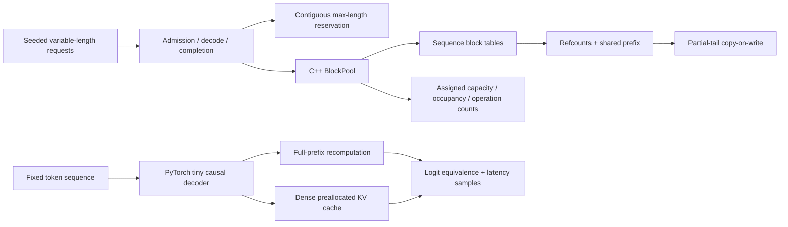

# KV Attention Lab

Small, runnable experiments on two costs in autoregressive inference: repeated prefix computation and wasted KV cache capacity. The project combines a C++17 block allocator with a PyTorch decoder and keeps their measurements separate.

**Runs locally on a CPU.** The checked-in results were collected on an Apple Silicon Mac with no NVIDIA GPU. No pretrained weights, credentials, or dataset downloads are required.

## What is implemented

- **C++ block pool:** per-sequence block tables, reference counts, explicit prefix sharing, copy-on-write for a shared partial tail, reclamation, and atomic capacity rejection before an append mutates state.
- **Deterministic serving workload:** 256 variable-length requests, arrivals and completions, private pages versus shared-prefix pages versus maximum-length contiguous reservation.
- **Actual causal decoder:** two transformer layers, preallocated dense K/V tensors, incremental prefill/decode, manual attention, and PyTorch scaled dot product attention (SDPA).
- **Correctness and measurements:** cached/full logits, future-token masking, non-square causal alignment, allocator differential tests, raw timing samples, and an explicit CUDA FlashAttention probe.

The C++ pool stores integer token markers to test ownership. It is a control-plane model inspired by [PagedAttention](https://arxiv.org/abs/2309.06180), not a CUDA PagedAttention implementation. The PyTorch experiment uses a separate dense tensor cache; connecting it to paged attention kernels is future work.

## Quick start

Python 3.10+ and a C++17 compiler are required. On macOS, Apple's command-line developer tools provide `make` and `clang++`.

```sh
python3 -m venv .venv
source .venv/bin/activate
python -m pip install -r requirements.txt

make test all
python -m pytest -q

./build/simulate > results/paging_cpu.json
python -m kv_attention_lab.benchmark --output results/local_cpu.json
```

Optional Apple GPU run, with synchronization around timed regions:

```sh
python -m kv_attention_lab.benchmark --device mps --output results/local_mps.json
```

The optional MPS path is not part of the checked-in CPU measurements. Benchmarking it checks availability and runs the same output comparisons before timing.

## Architecture



### Allocator invariants

`BlockPool::append` computes both new pages and any required tail copy before writing. If the free-list capacity is insufficient, the method throws `std::bad_alloc` and preserves token contents, sequence length, block table, and reference counts. Metadata capacity is reserved before any pool mutation. A full shared block remains immutable; only a partial shared tail requires a copy before an append.

`validate()` reconstructs every reference from live block tables, checks free-list uniqueness, and ensures every pool block is either owned or free. Tests include a 2,500-step seeded differential workload against ordinary token vectors, plus explicit shared-tail OOM and reclamation cases.

The allocator is single-threaded. Sharing is explicit through `fork_prefix`; there is no automatic hash-based prefix lookup, eviction policy, or cross-worker coordination.

### Causal alignment

Prefill has square attention, but incremental decode has query length 1 and a longer key cache. PyTorch documents `is_causal=True` on a non-square matrix as upper-left alignment. That would incorrectly expose only the first cached key for a single newest query. This implementation builds visibility from absolute query positions and passes a boolean mask with `is_causal=False`. Chunked cached prefill uses the same offset rule. See the [SDPA mask documentation](https://docs.pytorch.org/docs/2.8/generated/torch.nn.functional.scaled_dot_product_attention.html).

## Local results

Raw reports: [attention / decode](results/local_cpu.json), [paging workload](results/paging_cpu.json). These are one local run, not cross-hardware performance claims. The decoder is randomly initialized and the token workload is synthetic; no recommendation quality or model accuracy is implied.

### Causal decoder: real tensor execution

Environment: macOS arm64, Python 3.11, PyTorch 2.8.0, CPU float32, one intra-op thread and one inter-op thread. Batch 1; width 128; 4 attention heads; 2 layers; 128-token prompt; 24 prediction steps. Each sample includes prefill, logits, all decode steps, and cache allocation for the cached case. Five warmups precede 20 measured samples. Fixed teacher-forced tokens ensure identical inputs.

| Attention implementation | Full recomputation median | KV cache median | Median ratio | Largest cached/full logit error |
| --- | ---: | ---: | ---: | ---: |
| Manual matmul/softmax | 19.126 ms | 3.731 ms | 5.13× | 7.16e-7 |
| PyTorch SDPA | 18.386 ms | 3.248 ms | 5.66× | 8.35e-7 |

The ratio is against an intentionally simple baseline that recomputes every prefix, including projections and feed-forward layers. It is not an improvement over vLLM, TensorRT-LLM, or another production inference engine. CPU SDPA naming does not establish use of a CUDA kernel. The forced FlashAttention GPU probe is **skipped: CUDA unavailable**; [backend selection](https://docs.pytorch.org/docs/2.8/generated/torch.nn.attention.sdpa_kernel.html) is explicit in the probe.

Dense K/V tensor payload for this cache is **311,296 bytes**, verified from tensor element counts:

```text
2 × layers × batch × KV heads × reserved tokens × head dimension × dtype bytes
= 2 × 2 × 1 × 4 × 152 × 32 × 4
= 311,296 bytes
```

This is tensor payload, not process RAM, peak activation memory, or GPU memory. The experiment reserves 152 positions and uses at most 151 as input context while producing 24 next-token predictions.

### Block allocation: real bookkeeping on a simulated workload

Seed 42; 256 requests; 3 arrivals per tick; prompt length `30 + UniformInt[0,64]`; output length `UniformInt[8,32]`; 16-token pages; 128-token maximum reservation; 4,096-page pool. All modes receive the same requests. At most 66 requests are live.

| Policy | Peak assigned token capacity | Mean assigned token capacity | Capacity-weighted physical occupancy | Mean capacity reduction vs reservation |
| --- | ---: | ---: | ---: | ---: |
| Contiguous 128-token reservation | 8,448 | 5,816.77 | 57.84% | — |
| Private pages | 5,568 | 3,704.90 | 90.81% | 36.31% |
| Shared 30-token prefix + pages | 4,560 | 3,008.97 | 88.62% | 48.27% |

The shared-prefix policy performed **256 copy-on-write operations**, copying **3,584 token markers**, and returned all **1,202** page allocations to the free list. Sharing a non-aligned 30-token prefix exposes the copy cost of its 14-token tail. Fully aligned common prefix blocks can remain shared.

Definitions matter:

- **Assigned capacity** is the number of currently referenced physical pages multiplied by page size; the contiguous baseline instead reserves 128 slots per active request. The preallocated pool's host memory remains constant. The reported capacity reduction is not measured process-memory savings.
- **Physical occupancy** is `sum_t unique_live_physical_token_slots(t) / sum_t assigned_token_capacity(t)`. A shared slot is counted once; retained prefix-cache slots are included. It is bounded by 100%.
- **Request logical tokens per assigned slot** counts token references across requests and can exceed 1 with sharing. It is a sharing/amplification measure, not occupancy.
- **Mean capacity** is sampled after arrivals and before each decode/release tick. Paged peak capacity uses the allocator's high-water counter, including transient allocations between samples. Reserved peak uses maximum live reservations. All modes run the same 115 ticks.
- Simulation elapsed time includes request bookkeeping and occupancy scans; each value is a single run without warmups. Operation counts are the useful evidence here, not comparisons of these sub-millisecond times.

To translate assigned slots into an illustrative KV payload, multiply by `2 × layers × KV heads × head_dim × dtype_bytes`. Such a conversion is a model-dependent estimate, distinct from both the C++ token-marker storage and the actual PyTorch tensor payload above.

## Validation

```sh
make test
python -m pytest -q
```

Checked locally: allocator tests pass and **10 PyTorch tests pass**, covering both manual and SDPA paths, cached/full logit equivalence, chunked caching, no future-token visibility, one-query cache alignment, and capacity rejection. CI runs the same CPU checks plus short benchmark and JSON smoke runs. CUDA FlashAttention remains unvalidated on this machine.

## Useful experiments

Change one parameter while retaining the seed and inspect the reports:

```sh
# Aligned prefix avoids partial-tail COW.
./build/simulate --prefix 32 --max-seq 128

# Smaller pages reduce tail waste but increase allocation operations.
./build/simulate --block-size 8

# Longer context increases the recomputation work; rerun on the same device.
python -m kv_attention_lab.benchmark --prompt 256 --steps 32 --output results/longer_cpu.json
```

The next substantial extension is to connect block tables to real paged K/V tensor reads, then measure GPU kernels on available NVIDIA hardware. Other open work includes automatic prefix matching, concurrent ownership, eviction, and admission control under bounded capacity.

## References

- Kwon et al., [Efficient Memory Management for Large Language Model Serving with PagedAttention](https://arxiv.org/abs/2309.06180), SOSP 2023. Design inspiration for block ownership and sharing; its published performance numbers are not used as this project's results.
- PyTorch 2.8, [scaled dot product attention](https://docs.pytorch.org/docs/2.8/generated/torch.nn.functional.scaled_dot_product_attention.html): mask semantics, non-square causal alignment, and backend behavior.
- PyTorch 2.8, [SDPA backend selection](https://docs.pytorch.org/docs/2.8/generated/torch.nn.attention.sdpa_kernel.html): explicit backend probe.
- PyTorch 2.8, [MPS backend](https://docs.pytorch.org/docs/2.8/notes/mps.html): optional local Apple GPU execution.

MIT licensed. Copyright 2026 Qingquan Wang.
